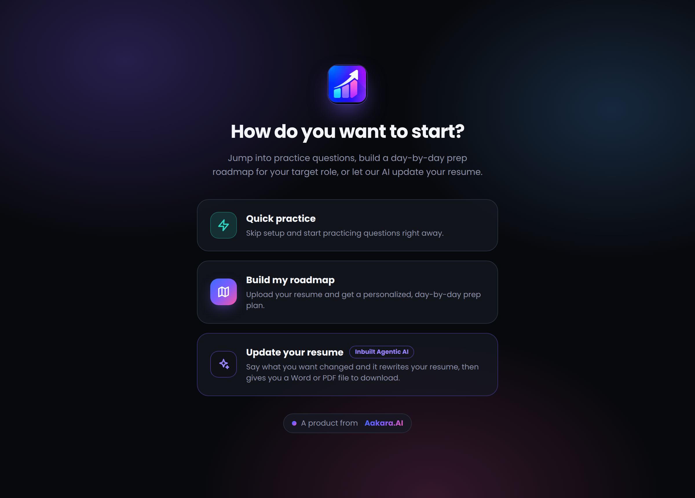
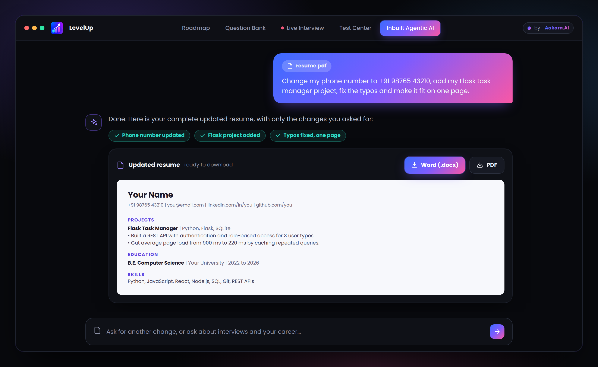
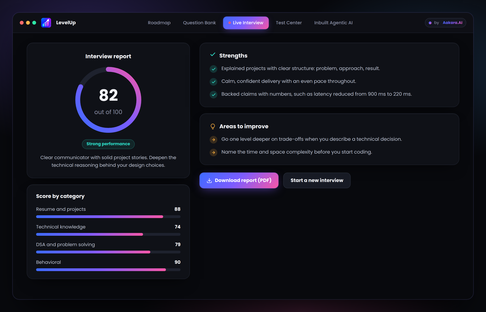

  

  <a href="https://interview-prep-1-bb0z.onrender.com/"><b>Live demo</b></a>
  &nbsp;|&nbsp;
  <a href="#features">Features</a>

# LevelUp: Make your move

**LevelUp** is an AI-powered career and interview preparation platform from **Aakara.AI**. It gives job seekers everything they need in one place: an **Inbuilt Agentic AI** that rewrites your resume for you, a personalized day-by-day prep roadmap, a live AI mock interviewer, role and company-style readiness tests, and a certificate when you pass.

Most candidates prepare without a plan, practice without feedback, and send out resumes they never had time to polish. LevelUp replaces guesswork with a clear path: fix your resume, know what to study today, practice answering out loud, measure your progress, and show it.

> **Try it now:** [interview-prep-1-bb0z.onrender.com](https://interview-prep-1-bb0z.onrender.com/)
> The demo runs on a free host, so the first load may take around 30 seconds to wake up.

  

---

## Features

### Inbuilt Agentic AI: your resume, updated for you

Attach your resume and tell the agent what you want in plain language, such as "change my phone number", "add this project", "remove the objective", "make it one page" or "fix the typos". It applies exactly those changes, leaves everything else untouched, and returns your **complete updated resume** along with a short summary of what changed. Then download it as a **Word (.docx)** or **PDF** file.

It keeps your real facts (employers, dates, degrees, numbers) and never invents experience. If a metric would help but is missing, it leaves a placeholder for you to fill in. You can keep asking for tweaks, and each new version builds on the last. It also answers questions about interviews and your career.

  

---

### Personalized roadmap

A plan built from your resume, your target role, your deadline and the hours you can study each day, not a generic checklist.

- Organized into **phases** (such as foundations, core topics, mock practice and final revision) that cover your whole timeline with no gaps.
- Time is broken into **daily, weekly or biweekly blocks** depending on how long you have, each with concrete, time-boxed tasks.
- References **specific strengths and gaps** found in your resume.
- A **progress ring** and checkable study blocks show how far along you are.
- Name your target companies and get a **round-by-round breakdown** for each one, with typical timing and prep tips, plus a one-click button to take that company's practice test.

  

> Company round breakdowns are a general guide based on commonly reported public patterns, not insider information.

---

### Live AI mock interview

An AI interviewer reads your resume, then interviews you **one question at a time**, adapting each follow-up to what you just said.

- **Adaptive questions** from Resume and Projects, Technical Knowledge, DSA and Problem Solving, System Design, and Behavioral (HR), at Easy, Medium or Hard difficulty.
- **Instant feedback** after every answer on clarity, technical depth, confidence and pace.
- **Voice or text:** speak your answers with your microphone, hear questions read aloud, and use your camera as a self-preview. Nothing is recorded or uploaded.
- Choose between 3 and 15 questions, set your experience level and pick your focus areas.

  

**Interview report.** At the end you get an overall score out of 100, category scores, strengths and areas to improve, plus a full transcript you can download as a **PDF**.

  

---

### Question bank

Prefer to study first? Generate a focused set of interview questions with model answers for your role, experience level and focus areas, based on your own resume.

---

### Test Center

Check your readiness with an **8-question multiple-choice test**, either general for your target role or styled after a specific company's commonly reported interview process (a mix of technical, aptitude and behavioral questions). Answers and explanations are only revealed after you submit, and a score of **70% or higher** passes.

  

---

### Certificate

Pass a test and download a **PDF certificate** and badge for your profile.

  

> The certificate is issued by LevelUp (Aakara.AI) based on practice-test performance. It is not an official credential from any company, and the certificate says so.

---

  <b>LevelUp</b>, a product from <b>Aakara.AI</b> 
  Make your move.

