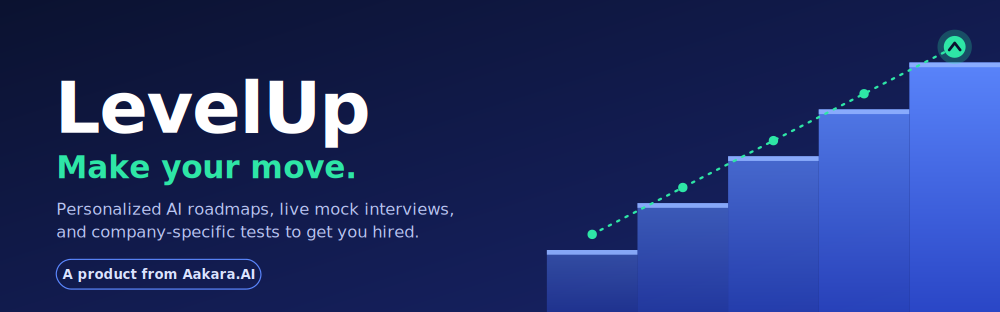
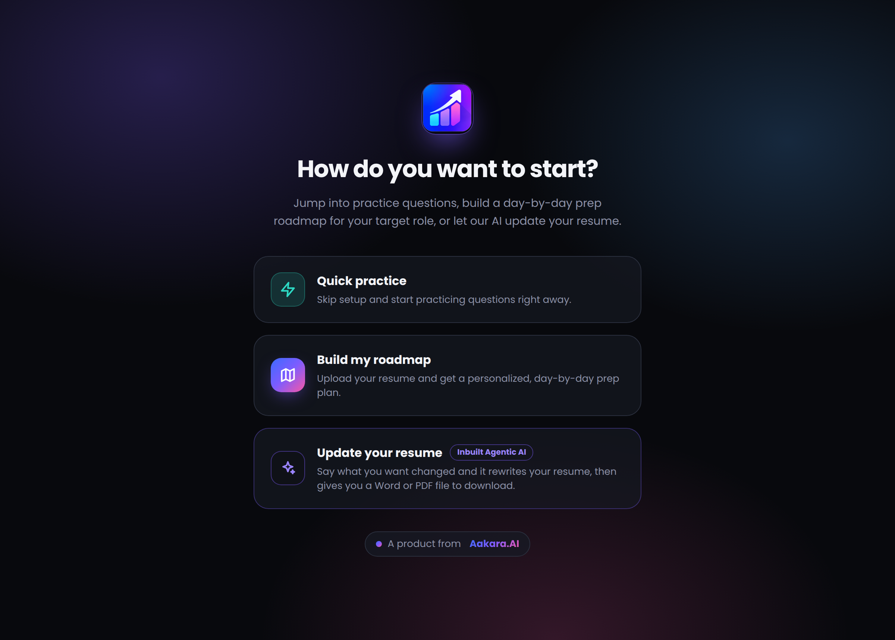
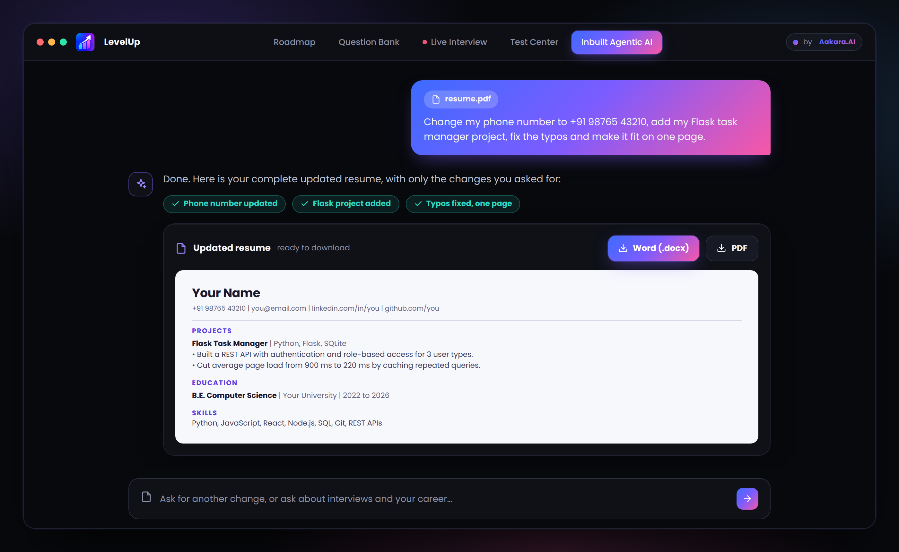
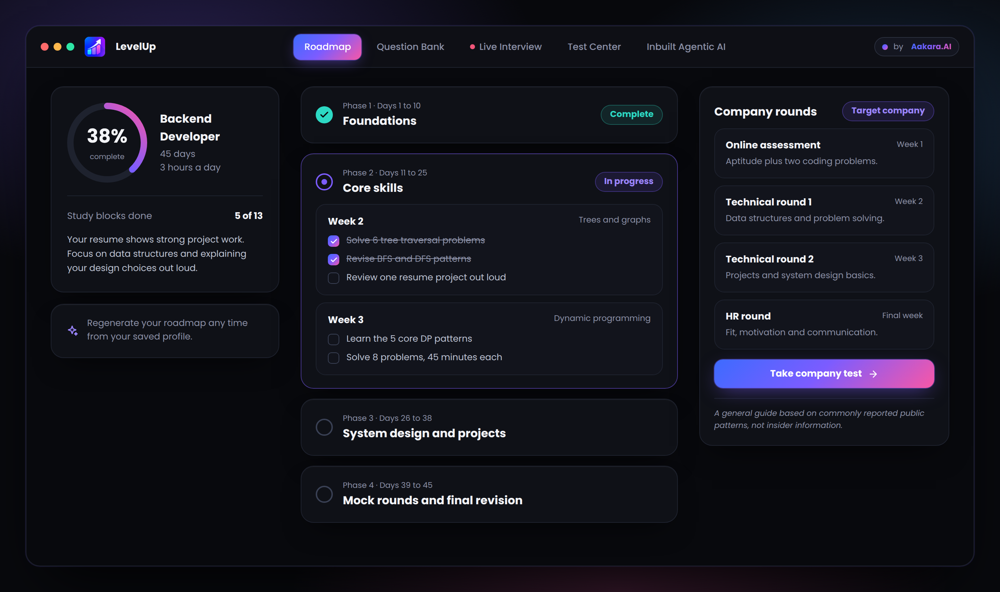
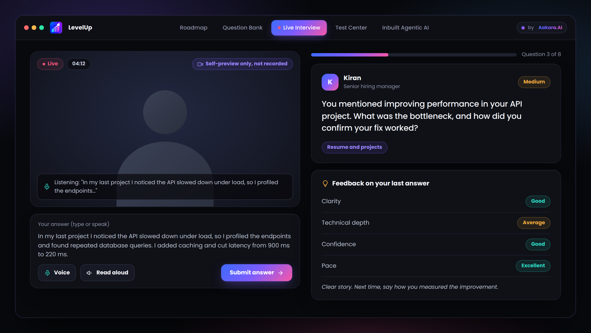
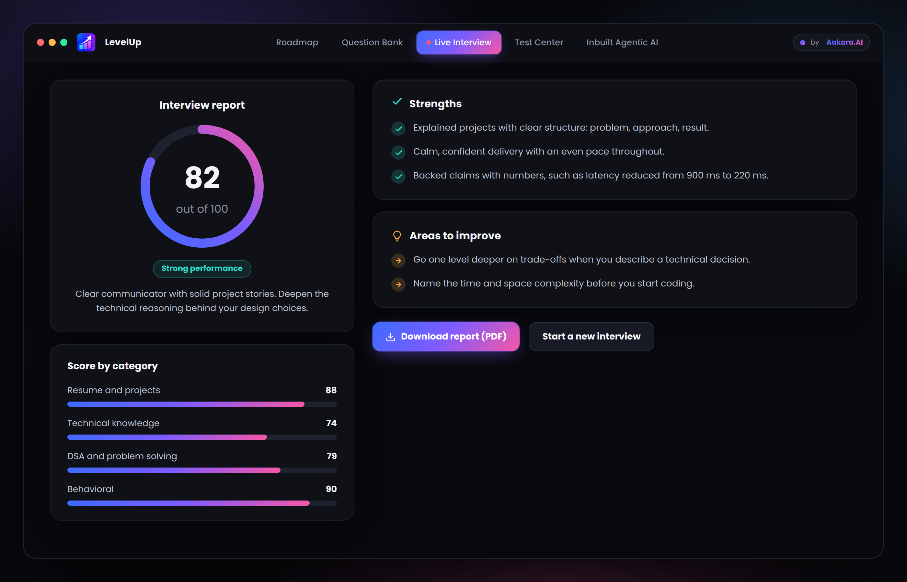
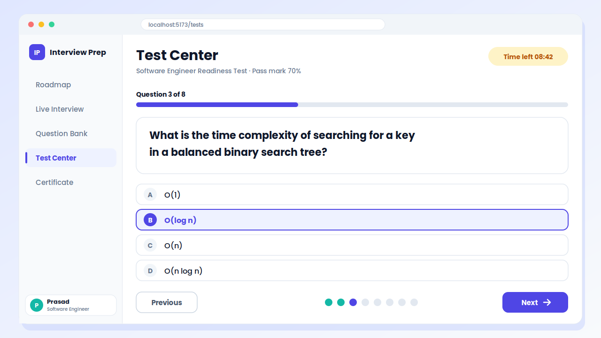
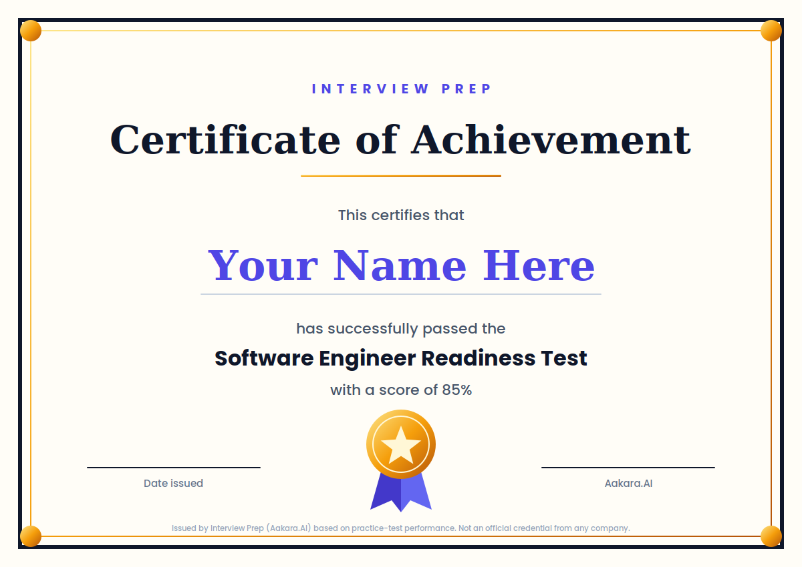

<p align="center">
  
</p>

<h1 align="center">LevelUp</h1>

<h3 align="center">Make your move.</h3>

<p align="center"><i>A product from <b>Aakara.AI</b></i></p>

<p align="center">
  <a href="https://interview-prep-1-bb0z.onrender.com/"></a>
</p>

<p align="center">
  
  
  
  
  
</p>

<p align="center">
  <a href="https://interview-prep-1-bb0z.onrender.com/"><b>Live Link</b></a>
  &nbsp;•&nbsp;
  <a href="#-features">Features</a>
  &nbsp;•&nbsp;
  <a href="#-how-it-works">How it works</a>
  &nbsp;•&nbsp;
  <a href="#-about">About</a>
</p>

---

## ✨ Overview

**LevelUp** is an AI-powered career and interview preparation platform from **Aakara.AI**. It gives job seekers everything they need in one place:

- 🤖 An **Inbuilt Agentic AI** that rewrites your resume for you
- 🗺️ A personalized **day-by-day prep roadmap**
- 🎤 A live **AI mock interviewer**
- 📝 Role and company-style **readiness tests**
- 🏅 A **certificate** when you pass

Most candidates prepare without a plan, practice without feedback, and send out resumes they never had time to polish. LevelUp replaces guesswork with a clear path: **fix your resume, know what to study today, practice answering out loud, measure your progress, and show it.**

> 🔗 **Try it now:** [interview-prep-1-bb0z.onrender.com](https://interview-prep-1-bb0z.onrender.com/)
>
> ⏳ The demo runs on a free host, so the first load may take around 30 seconds to wake up.

<p align="center">
  
</p>

---

## 🚀 Features

| | Feature | What you get |
|---|---|---|
| 🤖 | [Inbuilt Agentic AI](#-inbuilt-agentic-ai-your-resume-updated-for-you) | Plain-language resume edits, downloadable as Word or PDF |
| 🗺️ | [Personalized Roadmap](#%EF%B8%8F-personalized-roadmap) | Phases, daily tasks and company round breakdowns |
| 🎤 | [Live AI Mock Interview](#-live-ai-mock-interview) | Adaptive questions, instant feedback, voice or text |
| 📚 | [Question Bank](#-question-bank) | Role-specific questions with model answers |
| 📝 | [Test Center](#-test-center) | 8-question readiness tests, 70% to pass |
| 🏅 | [Certificate](#-certificate) | PDF certificate and badge when you pass |

---

### 🤖 Inbuilt Agentic AI: your resume, updated for you

Attach your resume and tell the agent what you want in plain language:

> *"change my phone number"* • *"add this project"* • *"remove the objective"* • *"make it one page"* • *"fix the typos"*

It applies exactly those changes, leaves everything else untouched, and returns your **complete updated resume** with a short summary of what changed. Then download it as a **Word (.docx)** or **PDF** file.

- ✅ Keeps your real facts (employers, dates, degrees, numbers) and never invents experience
- ✅ Leaves a placeholder for you to fill in when a metric would help but is missing
- ✅ Keep asking for tweaks; each new version builds on the last
- ✅ Also answers questions about interviews and your career

<p align="center">
  
</p>

---

### 🗺️ Personalized Roadmap

A plan built from your resume, your target role, your deadline and the hours you can study each day, not a generic checklist.

- 📅 Organized into **phases** (foundations, core topics, mock practice, final revision) covering your whole timeline with no gaps
- ⏱️ Time broken into **daily, weekly or biweekly blocks**, each with concrete, time-boxed tasks
- 🎯 References **specific strengths and gaps** found in your resume
- 📈 A **progress ring** and checkable study blocks show how far along you are
- 🏢 Name your target companies and get a **round-by-round breakdown** for each one, with typical timing, prep tips and a one-click button to take that company's practice test

<p align="center">
  
</p>

> ℹ️ Company round breakdowns are a general guide based on commonly reported public patterns, not insider information.

---

### 🎤 Live AI Mock Interview

An AI interviewer reads your resume, then interviews you **one question at a time**, adapting each follow-up to what you just said.

| Capability | Details |
|---|---|
| **Adaptive questions** | Resume and Projects, Technical Knowledge, DSA and Problem Solving, System Design, Behavioral (HR) |
| **Difficulty** | Easy, Medium or Hard |
| **Instant feedback** | Clarity, technical depth, confidence and pace after every answer |
| **Voice or text** | Speak with your microphone, hear questions read aloud, use your camera as a self-preview |
| **Fully customizable** | 3 to 15 questions, your experience level, your focus areas |

🔒 Nothing is recorded or uploaded.

<p align="center">
  
</p>

#### 📊 Interview Report

At the end you get an **overall score out of 100**, category scores, strengths and areas to improve, plus a full transcript you can download as a **PDF**.

<p align="center">
  
</p>

---

### 📚 Question Bank

Prefer to study first? Generate a focused set of interview questions **with model answers** for your role, experience level and focus areas, based on your own resume.

---

### 📝 Test Center

Check your readiness with an **8-question multiple-choice test**, either general for your target role or styled after a specific company's commonly reported interview process (a mix of technical, aptitude and behavioral questions).

- Answers and explanations are revealed only after you submit
- A score of **70% or higher** passes

<p align="center">
  
</p>

---

### 🏅 Certificate

Pass a test and download a **PDF certificate** and badge for your profile.

<p align="center">
  
</p>

> ℹ️ The certificate is issued by LevelUp (Aakara.AI) based on practice-test performance. It is not an official credential from any company, and the certificate says so.

---

## 🧭 How it works

```text
  Upload resume  ➜  Fix it with the AI agent  ➜  Get your roadmap
                                                        │
        Show your certificate  ◀──  Take readiness tests  ◀──  Mock interviews
```

1. **Update your resume** with the Agentic AI and download it
2. **Build your roadmap** around your role, deadline and daily hours
3. **Practice live** with the AI interviewer and review your report
4. **Test yourself** with role or company-style tests
5. **Earn your certificate** and show your progress

---

## 💡 About

**LevelUp** is built by **Aakara.AI** to help candidates prepare with a plan, practice with feedback, and walk into interviews ready.

<br>

<p align="center">
  
</p>

<p align="center"><b>LevelUp</b> &nbsp;|&nbsp; Make your move.</p>

<p align="center"><sub>A product from <b>Aakara.AI</b></sub></p>
