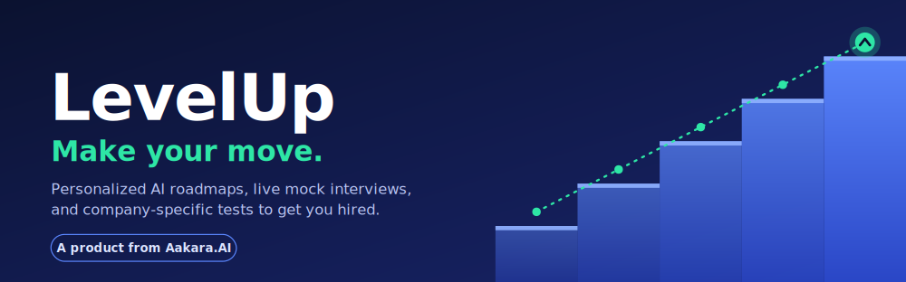
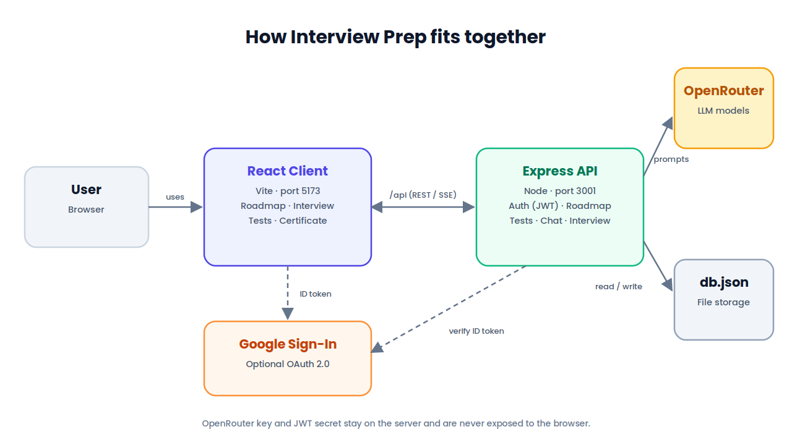
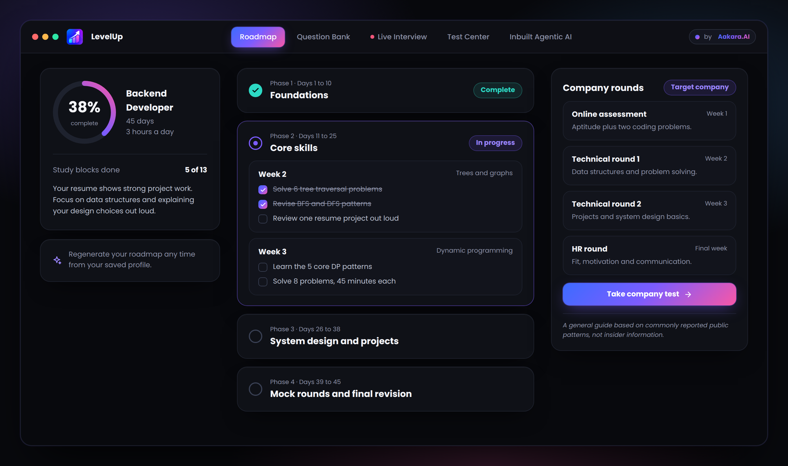
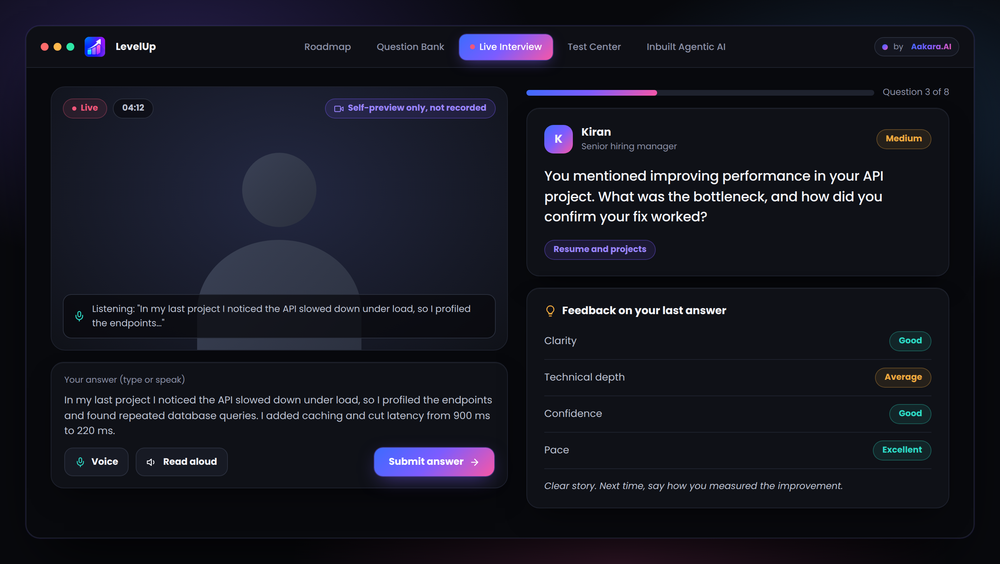
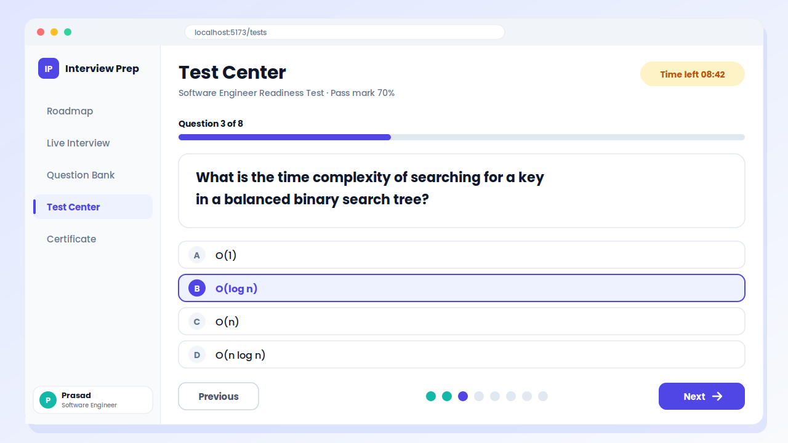
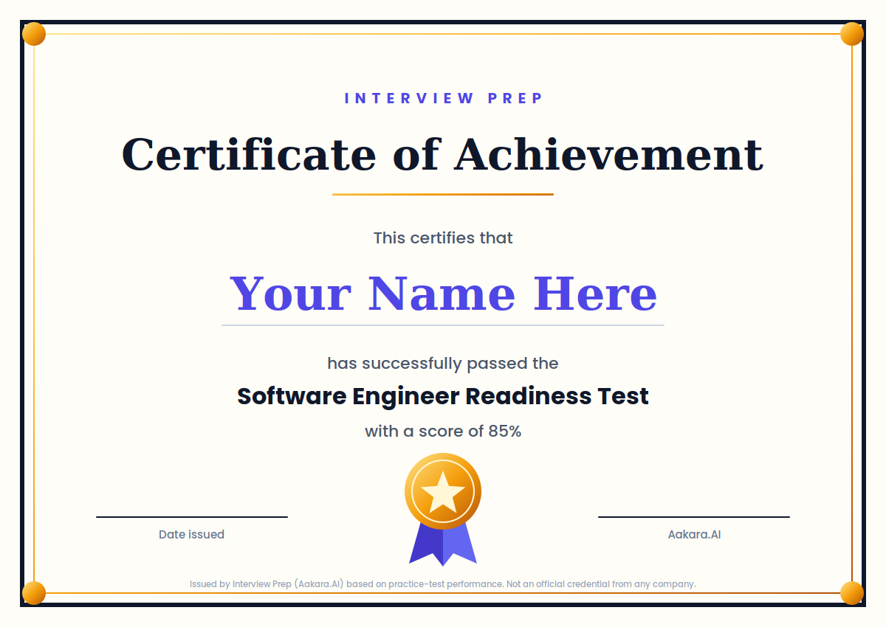

<p align="center">
  
</p>

<p align="center">
  <a href="https://interview-prep-1-bb0z.onrender.com/"><b>Live demo</b></a>
  &nbsp;|&nbsp;
  <a href="#how-it-works">How it works</a>
  &nbsp;|&nbsp;
  <a href="#features">Features</a>
  &nbsp;|&nbsp;
  <a href="#tech-stack">Tech stack</a>
</p>

# LevelUp: Make your move

**LevelUp** is an AI-powered interview preparation platform from **Aakara.AI**. Upload your resume once and LevelUp builds a personalized day-by-day roadmap, puts you in front of a live AI mock interviewer, tests your readiness in role or company style, and awards a certificate when you pass.

Most candidates prepare without a plan, practice without feedback, and walk into interviews unsure where they stand. LevelUp replaces guesswork with a clear path: know what to study today, practice answering out loud, measure your progress, and show it.

> **Try it now:** [interview-prep-1-bb0z.onrender.com](https://interview-prep-1-bb0z.onrender.com/)
> The demo runs on a free host, so the first load may take around 30 seconds to wake up.

---

## How it works

<p align="center">
  
</p>

1. **Upload your resume.** Paste it or upload a file once. Tell LevelUp your target role, how many days you have, how many hours you can study each day, and (optionally) the companies you are aiming for.
2. **Get your roadmap.** LevelUp turns your profile into a phase-by-phase schedule sized to your deadline, plus a round-by-round breakdown for each target company.
3. **Practice live.** Answer questions from a conversational AI interviewer and get feedback after every response, or generate a question bank with model answers.
4. **Take the readiness test.** An 8-question multiple-choice test, either role-based or styled after a company's process.
5. **Get certified.** Score 70% or more and download a PDF certificate.

---

## Features

### Personalized roadmap

A plan built from your resume, your timeline, and your time budget, not a generic checklist. Tick off schedule blocks as you finish them and watch your progress climb. For each company you name, LevelUp outlines the typical interview rounds based on commonly reported public patterns.

<p align="center">
  
</p>

> Company round breakdowns are a general guide drawn from public patterns, not insider information.

### Live AI mock interview

Talk through real interview questions tailored to your resume and role. After each answer you get scores for clarity, depth, and structure, along with a concrete tip to improve. End early at any time to get a wrap-up report.

<p align="center">
  
</p>

### Question bank

Prefer to study first? Generate a focused set of interview questions with model answers for your role, experience level, and focus areas.

### Test Center and certificate

Check your readiness with an 8-question test, either general for your role or styled after a target company's process. Pass with 70% or higher to unlock a downloadable PDF certificate and badge.

<p align="center">
  
</p>

<p align="center">
  
</p>

> The certificate is issued by LevelUp (Aakara.AI) based on practice-test performance. It is not an official credential from any company, and the certificate says so.

---

## Tech stack

| Layer | Technology |
| ----- | ---------- |
| Frontend | React with Vite |
| Backend | Node.js and Express |
| AI | LLMs via [OpenRouter](https://openrouter.ai) (model is configurable) |
| Auth | Email and password, optional Google sign-in, JWT sessions |
| Storage | Flat-file JSON store (swappable, see [data storage](#data-storage-note)) |

```
interview-prep/
├── server/     Express API: auth, roadmap and test generation, storage
└── client/     React (Vite) UI
```

---

## Data storage note

Accounts, profiles, roadmaps, and test results are stored in a flat `server/data/db.json` file. That is fine for local development and small deployments, but:

- **It is not production-ready for real users as-is.** On hosts with an ephemeral filesystem (for example Render's free tier without a persistent disk), all data is wiped on every redeploy or restart.
- Before opening LevelUp to real users, attach a persistent disk or migrate `server/src/db.js` to a real database such as Postgres. The functions there are already isolated to make that swap straightforward.

---

## Roadmap

- [ ] Scope chat, question bank, and live interview features to user accounts
- [ ] Move storage to a real database (Postgres)
- [ ] Rate limiting and per-user cost controls
- [ ] Email verification and password reset
- [ ] Deployment guide for the client (Vercel, Netlify) and server (Render, Fly.io, Railway)

---

<p align="center">
  <b>LevelUp</b>, a product from <b>Aakara.AI</b><br>
  Make your move.
</p>
